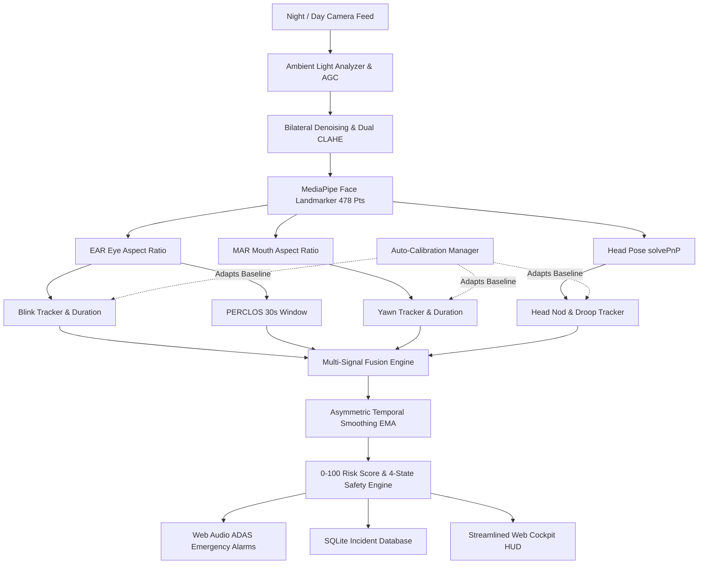

# DriveSafe: Real-Time AI Driver Drowsiness Detection & Telemetry Cockpit

[](https://www.python.org/)
[](https://opencv.org/)
[](https://developers.google.com/mediapipe)
[](https://flask.palletsprojects.com/)
[](https://www.sqlite.org/)

DriveSafe is an end-to-end, automotive-grade Driver Monitoring System (DMS) engineered in Python, OpenCV, and Google MediaPipe Tasks. Designed for low-latency edge deployment, DriveSafe fuses multiple physiological and kinematic biomarkers into an adaptive **0–100 Drowsiness Risk Score** across four safety states: **Safe, Caution, High Risk, and Critical Alert**.

---

## Key Features

- **🌙 Night Driver Vision & Low-Light Enhancement**:
  - Automatic ambient illumination analyzer ($\mu_L < 85$).
  - Adaptive Gamma Correction (AGC) with non-linear shadow expansion ($\gamma = 0.40 - 0.70$).
  - Edge-preserving bilateral filtering to suppress CMOS high-gain digital noise.
  - Dual-pass high-contrast CLAHE extracting eyelid and iris boundaries in pitch-black cabins.
  - Multi-exposure rescue pass for unlit rural night driving.
- **👁️ Multimodal Biometric Fusion**:
  - **EAR (Eye Aspect Ratio)**: Euclidean landmark distance geometry for blink dynamics and microsleeps.
  - **PERCLOS (NHTSA Standard)**: Percentage of eye closure over a 30-second moving time window.
  - **MAR (Mouth Aspect Ratio)**: Temporal yawn verification distinguishing speech from true fatigue.
  - **3D Head Pose Estimation**: Perspective-n-Point (`cv2.solvePnP` SQPNP) computing Pitch, Yaw, and Roll Euler angles for head droop detection.
- **✨ Streamlined Luxury Automotive Cockpit UI**:
  - Minimalist 2-column layout inspired by modern automotive dashboards (Tesla Autopilot, Apple CarPlay).
  - Glowing circular risk index gauge with live dynamic state badges.
  - 4 human-readable safety vitals: Eye State, Blink Activity, Head Posture, and Yawning.
  - Live 60-second sliding telemetry risk wave.
- **📷 Camera Hardware & Privacy Control**:
  - Direct hardware webcam control with Camera ON/OFF toggle releasing the device when inactive.
  - WebRTC browser camera mode and interactive simulator mode.
- **🔊 Zero-Latency Procedural Acoustic Alarms**:
  - Pure Web Audio API synthesis generating urgent ADAS dual-oscillator sirens ($1100\text{ Hz} \leftrightarrow 1500\text{ Hz}$) with zero audio lag.
- **⚙️ Personalized Statistical Auto-Calibration**:
  - 10-second driver calibration establishing personalized open-eye and posture baselines.

---

## Architecture Overview



---

## Biometric Formulations

### 1. Eye Aspect Ratio (EAR)
Derived using 6 Euclidean landmarks per eye from the facial mesh:
$$EAR = \frac{\|p_2 - p_6\| + \|p_3 - p_5\|}{2 \cdot \|p_1 - p_4\|}$$

### 2. PERCLOS (Percentage of Eye Closure)
Standard NHTSA metric measuring eye closure duration over a moving window ($T = 30\text{s}$):
$$\text{PERCLOS} = \frac{1}{T} \int_{t-T}^{t} \mathbb{I}(EAR(\tau) < EAR_{threshold}) \, d\tau$$

### 3. Mouth Aspect Ratio (MAR)
$$MAR = \frac{\|p_{81} - p_{178}\| + \|p_{13} - p_{14}\| + \|p_{311} - p_{402}\|}{2 \cdot \|p_{61} - p_{291}\|}$$

### 4. 3D Head Pose via Perspective-n-Point (`cv2.solvePnP`)
Solves rigid transformation between canonical 3D facial coordinates and 2D pixel coordinates:
$$s \begin{bmatrix} u \\ v \\ 1 \end{bmatrix} = \mathbf{K} \left( \mathbf{R} \begin{bmatrix} X \\ Y \\ Z \end{bmatrix} + \mathbf{t} \right)$$

---

## Quickstart Guide

### 1. Requirements
Ensure Python 3.10+ is installed:
```bash
pip install -r requirements.txt
```

### 2. Launch DriveSafe
```bash
python app.py
```
Open your browser at:
```
http://127.0.0.1:5000
```

---

## License
MIT License. Built for advanced driver safety research and edge AI deployment.
